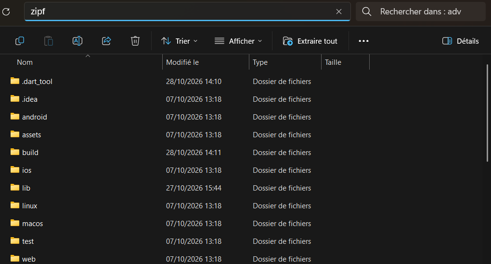

# zip_flutter / zipf

Un utilitaire en ligne de commande rapide en Rust pour archiver automatiquement vos projets Flutter sous forme de fichiers ZIP en filtrant les fichiers temporaires et de build.

> **Pourquoi `zipf` ?** Fini le besoin de passer par WSL et de lancer un script Bash! `zipf` fonctionne en natif sous Windows, instantanément et sans dépendance.

##  Fonctionnalités

- **Horodatage automatique** : Génère des archives sous la forme `nom-du-dossier_remise_AAAAMMJJ_HHMMSS.zip`.

- **Filtrage intelligent** : Exclut automatiquement `build`, `.dart_tool`, `.git`, `.idea`, `.vscode`, les dossiers plateformes (`android`, `ios`, etc.), ainsi que les fichiers `.log`, `.iml` et `.gitignore`.

## Installation

Exécutez `zipf_setup.exe` pour installer l'outil et l'ajouter automatiquement à votre `PATH`.

##  Utilisation 

Dans votre dossier courants, tapez directement zipf pour créer l'archive.

```cmd
zipf
```
Example : 

